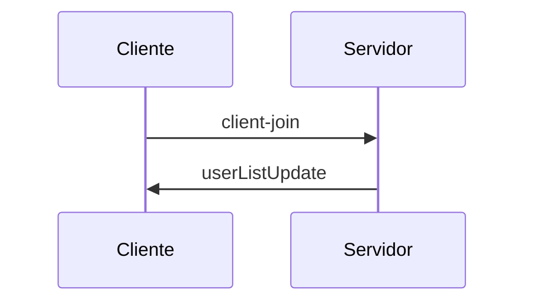

# 1 - Protocolo cliente-servidor
Un cliente se conecta pr WwebSocket a un servidor y le manda mensajes. Hay 3 rooms precreados y el usuario puede estar en uno a la vez y cambiarse cuando quiera.

## Mensaje que manda el cliente
Unirse a un room (o cambiar de room)
{
  "action": "client-join",
  "username": "<nombre>",
  "room": "<room>"
}

Enviar mensaje de chat al room
{
  "action": "message",
  "username": "<nombre>",
  "room": "<room>",
  "text": "<texto>"
}

## Mensaje que manda el servidor al cliente
Aviso del sistema (alguien entro, cambio de room o se desconecto)
{
  "type": "system",
  "text": "<nombre> entered the room"
}

Actualizacion de la lista de usuarios del room
{
  "type": "userListUpdate",
  "users": ["<usuario1>", "<usuario2>"]
}

## Diagrama: Un cliente entra a un room

# 2 - Protocolo entre servidores
Para que los servidores formen una red, cada uno tiene una conexion abierta con todos los demas. Para esto se usa la operacion server-join

## server-join
El servidor nuevo se conecta a cualquier servidor ya existente

1- new-server --> known-server
{
  "action": "<server-join>",
  "url": "<new-server-url>"
}

2- known-server --> new-server
{
  "response": "other-servers",
  "other-servers": ["<server1_url>","<server2_url>"]
}

Aca ya se resgistraron entre ellos, el known-server guarda al new-server y el new-server guarda al known-server

3- new-server --> cada servidor de la lista
{
  "action": "server-joined",
  "name": "<new-server-url>"
}

El new-server ses conecta a cada servidor de la lista y tambien los registra

4- Cada servidor que recibe server-joined registra al new-server

Al final cada servidor tiene un socket abierto con todos los demas.

## Diagrama server-join

## Sibcronizacion de cientes entre servidores
Para que la lista de usuarios y los mensajes de un room inlcluyan a clientes de otros servidores, cada servidor se comunica con los demas.
Un cliente entro a un oom o cambio de room, y su servidor reenvia el mensaje a los demas servidores.

{
  "action": "client-join",
  "username": <nombre>",
  "room": "<room>"
}

Un cliente se fue del chat:
{
  "action": "client-leave",
  "username": "<nombre>"
  "room": "<room>"
}

Servidor nuevo recien conectado. Cada servidor le manda un client-join por cada cliente que tiene conectado, asi se entera de quien esta en que room.

Mensajes de chat: si el mensaje lo manda un ciente entonces el servidor lo reenvia a los demas. Si viene desde otro servidor no se reenvia, para evitar que se repita

## Diagrama: servidor nuevo recien conectado

## Diagrama: clientes en distintos servidores
