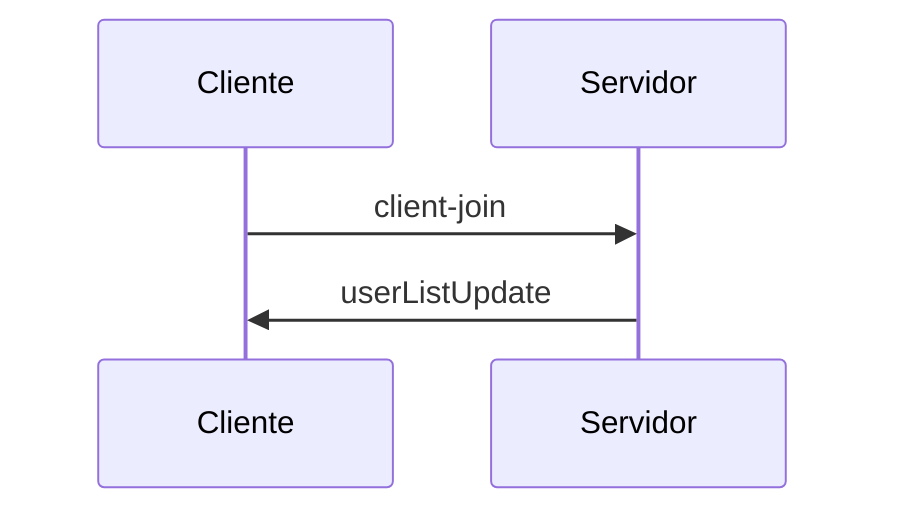
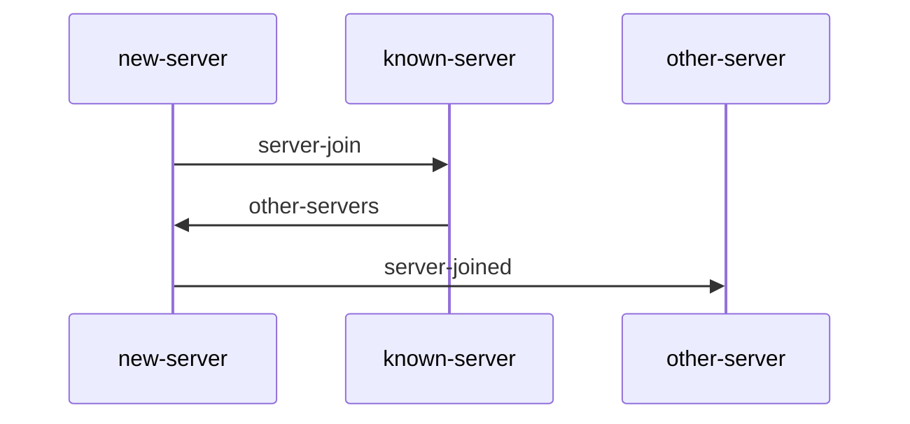
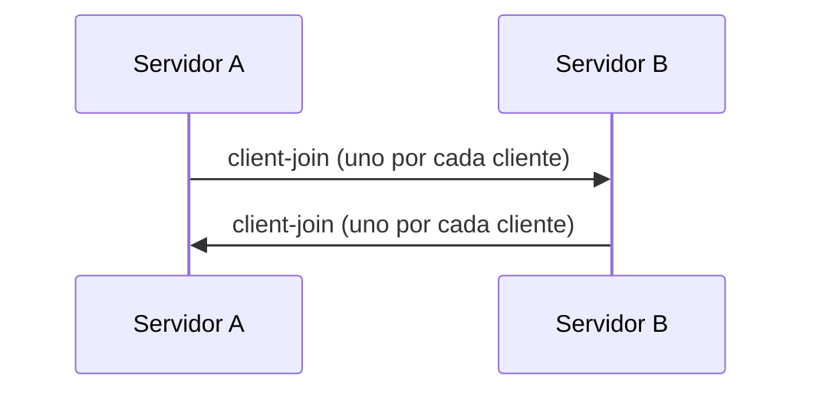
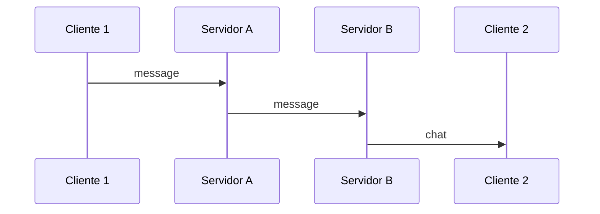

# 1) Protocolo cliente-servidor

Un cliente se conecta por WebSocket a un servidor y le manda mensajes. Hay 3 rooms precreados y el usuario puede estar en uno a la vez y cambiarse cuando quiera.

## Mensajes que manda el cliente

Unirse a un room (o cambiar de room)

```json
{
  "action": "client-join",
  "username": "<nombre>",
  "room": "<room>"
}
```

Enviar un mensaje de chat al room

```json
{
  "action": "message",
  "username": "<nombre>",
  "room": "<room>",
  "text": "<texto>"
}
```

## Mensajes que manda el servidor al cliente

Aviso del sistema (alguien entró, cambió de room o se desconectó)

```json
{
  "type": "system",
  "text": "<nombre> entered the room."
}
```

Actualización de la lista de usuarios del room

```json
{
  "type": "userListUpdate",
  "users": ["<usuario1>", "<usuario2>"]
}
```

## Diagrama: un cliente entra a un room



---

# 2) Protocolo entre servidores

Para que los servidores formen una red, cada uno tiene que tener una conexión abierta con todos los demás. Para eso se usa la operación server-join.

## server-join (lo inicia un servidor nuevo)

El servidor nuevo se conecta a cualquier servidor ya existente.

**1: new-server → known-server**

```json
{
  "action": "server-join",
  "url": "<new-server-url>"
}
```

**2: known-server → new-server**

```json
{
  "response": "other-servers",
  "other_servers": ["<server1_url>", "<server2_url>"]
}
```

Acá ya se registran entre ellos: el known-server guarda al new-server y el new-server guarda al known-server. La lista no incluye al new-server.

**3: new-server → cada servidor de la lista**

```json
{
  "action": "server-joined",
  "name": "<new-server-url>"
}
```

El new-server se conecta a cada servidor de la lista y también los registra.

**4:** cada servidor que recibe server-joined registra al new-server.

Al final, cada servidor tiene un socket abierto con todos los demás.

### Diagrama: server-join



## Sincronización de clientes entre servidores

Para que la lista de usuarios y los mensajes de un room incluyan a clientes de otros servidores, cada servidor se comunica con los demás.

Un cliente entró a un room o cambió de room. Su servidor reenvía el mensaje a los demás servidores:

```json
{
  "action": "client-join",
  "username": "<nombre>",
  "room": "<room>"
}
```

Un cliente se fue del chat (o cambió de nombre, en cuyo caso se avisa con el nombre viejo):

```json
{
  "action": "client-leave",
  "username": "<nombre>",
  "room": "<room>"
}
```

Servidor nuevo recién conectado. Cada servidor le manda un client-join por cada cliente que tiene conectado, así se entera de quién está en qué room.

Mensajes de chat. Si el mensaje lo manda un cliente, el servidor lo reenvía a los demás servidores. Si vino de otro servidor no se reenvía, para evitar que se repita.

### Diagrama: servidor nuevo recién conectado



### Diagrama: clientes en distintos servidores


